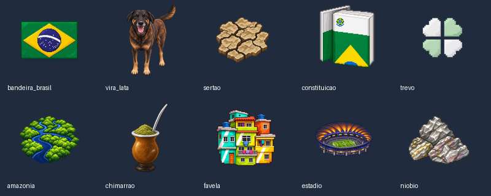

# Arte das árvores de habilidades

Os 33 PNGs de `Arte/Skill Tree Icons em PNG` foram adaptados para texturas RGBA de 128 × 128, com transparência, proporção preservada e margem de 4 pixels. A compressão PNG é sem perdas após o redimensionamento.

Os ícones são itens internos com modelos `minecraft:item/generated` e texturas em `textures/item/skilltree`, compatíveis com a API de ItemStack do UI Lib. Todos estão disponíveis na aba criativa TupiniCraft. Para usar um em um datapack, defina `"icone": "tupinicraft:icone_<nome>"`. Todos os arquivos de árvores e as quatro skills existentes já usam as artes correspondentes. Árvores sem habilidades continuam sem aba, como antes.

Os emblemas separados de partidos não foram vinculados ao partido genérico de teste. A funcionalidade de partidos completos continua fora do escopo.

| Nome do ícone | Arquivo original | PNG final (bytes) |
| --- | --- | ---: |
| `cristo_redentor` | Cristo Redentor em pixel art.png | 12,289 |
| `mao_em_l` | Mão vermelha em L pixelada.png | 9,412 |
| `rejeicao` | Carimbo vermelho com X de rejeição-5.png | 15,500 |
| `policia_federal` | Policia_Federal_Paródia.png | 21,241 |
| `vacina` | Frasco de vacina com faixa turquesa-3.png | 7,152 |
| `moeda_real` | Moeda de um real em pixel art-8.png | 21,220 |
| `receita_federal` | Receita Federal_Paródia.png | 8,017 |
| `chimarrao` | Ícone de cuia de chimarrão-7.png | 10,259 |
| `bandeira_brasil` | Bandeira brasileira em pixel art-4.png | 11,576 |
| `caveira` | Emblema de caveira e armas douradas-11.png | 18,559 |
| `favela` | Aglomerado colorido de casas na favela-6.png | 19,936 |
| `estadio` | Estádio Brasileiro.png | 14,453 |
| `amazonia` | Floresta Amazônica.png | 17,959 |
| `tigrinho` | TigrinhoBets.png | 20,229 |
| `pix` | Emblema parecido com PIX.png | 14,087 |
| `vira_lata` | Cão mestiço feliz em pixel art-9.png | 17,236 |
| `trevo` | Trevo de quatro folhas pixelado.png | 7,007 |
| `comprimido` | Comprimido pixelado com homem de terno-2.png | 13,210 |
| `mito` | Mito do PL Genérico.png | 17,715 |
| `identidade_dinheiro` | Documento de Identidade com notas de dinheiro.png | 16,101 |
| `niobio` | Nióbio.png | 17,480 |
| `picanha` | Picanha.png | 9,653 |
| `jumento` | Jumento.png | 16,268 |
| `cus` | Emblema do CUS.png | 6,127 |
| `bolsa` | Bolsa.png | 5,406 |
| `constituicao` | Constiuição.png | 13,795 |
| `carteira_trabalho` | Carteira de Trabalho.png | 17,766 |
| `montanha` | Ícone azul de montanha geométrica-10.png | 9,803 |
| `cedulas` | Cédulas brasileiras pixel art.png | 11,033 |
| `mst` | Símbolo MST.png | 11,566 |
| `intelectual` | Intelectual do PL Genérico.png | 15,360 |
| `painho` | Painho do PT Genérico.png | 17,181 |
| `sertao` | SecaNoNordeste.png | 15,408 |

Total original: 26,259,860 bytes. Total otimizado: 460,004 bytes. Redução: 98.2%.
